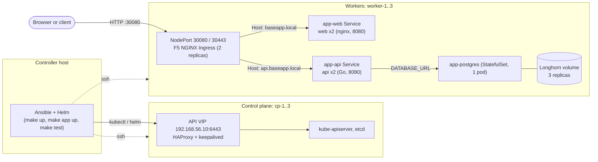

# Athena

A local Kubernetes platform on libvirt VMs, built and managed with Ansible. The VMs, the host preparation, and the cluster all come from this repository, so the environment can be recreated from version control.

## Layout

| Path | Purpose |
|---|---|
| `Makefile` | Entry points: `make host-setup`, `make vm ...`, `make k8s ...` |
| `vm/` | Vagrantfile and box pins. Builds one VM per host in the inventory |
| `ansible/inventories/hosts.yaml` | The six VMs and their groups |
| `ansible/inventories/group_vars/` | Shared pins and settings (versions, digests, registry, VIP) |
| `ansible/playbooks/host-setup.yaml` | Prepares the controller host (runs on localhost) |
| `ansible/playbooks/k8s-setup.yaml` | Brings up the whole cluster, in order |
| `ansible/playbooks/k8s-status.yaml` | Read-only validation of the nodes and the cluster |
| `ansible/roles/` | One role per component. Each role has a README |

## Prerequisites

- Ubuntu 24.04 controller with KVM (`/dev/kvm`) and libvirt.
- Ansible on the controller.
- Passwordless or prompted sudo for your user.
- Network access to `docker.novin.cloud` (container images), `pkgs.k8s.io`, `quay.io`, `ghcr.io`, and `github.com`.
- If `/usr/bin/sudo` is sudo-rs, export `ANSIBLE_BECOME_EXE=/usr/bin/sudo.ws` before `make host-setup`. See `ansible/roles/host_setup/README.md`.

## Usage

To bring everything up in one go (host setup, VMs, cluster, and the app; no failure checks):

```
make up
```

Or run the steps in this order:

```
make host-setup     # once per controller: Vagrant, libvirt, and the libvirt ACL
make vm up          # create and start the six VMs
make k8s up         # configure the VMs and bring up the cluster
make k8s status     # validate the nodes and the cluster; fails if any check fails
make app up         # deploy the sample app at the latest vX.Y.Z-release tag
make test           # the full acceptance test; fails and names the failed checks
make failure        # pod and node failure exercises; or make failure pod|node. See docs/failure-exercise.md
```

Other commands:

```
make vm down        # halt the VMs and keep their disks
make vm status      # show VM state
make vm destroy     # delete the VMs. Never run automatically
```

To inspect the cluster, log in to cp-1 and run `kubectl` or `k9s` there. Both use the admin kubeconfig already in place, so no flag is needed:

```
ssh -i vm/.vagrant/machines/athena-cp-1/libvirt/private_key vagrant@192.168.56.11
kubectl get nodes
k9s
```

Every `make k8s up` step is safe to repeat. A second run on a healthy cluster changes nothing.

## Topology

| Node | Address | Role |
|---|---|---|
| `athena-cp-1..3` | 192.168.56.11–13 | Control plane (etcd, API server), HAProxy, keepalived |
| `athena-worker-1..3` | 192.168.56.21–23 | Workloads, Longhorn volumes |
| API VIP | 192.168.56.10:6443 | Control-plane endpoint, held by keepalived |

The `make k8s up` play order is `node_tuning`, `haproxy_keepalived`, `kubernetes_base`, `kubeadm_control_plane`, `kubeadm_worker`, the Longhorn iSCSI tasks on the workers, then `helm`, `cilium`, `longhorn`, and `ingress_nginx` on the first control-plane node.

## Architecture and traffic flow



- **Client to app**: a request to `baseapp.local` or `api.baseapp.local` on a worker's NodePort 30080 reaches the F5 NGINX Ingress. The ingress routes by host to the `app-web` or `app-api` Service. Cilium replaces kube-proxy and load-balances the Service to a ready pod.
- **API to database**: the API reaches `app-postgres` through its Service, with the connection string from the `app-secrets` Secret. The migrate Job runs after each install or upgrade.
- **Cluster control**: kubectl and Helm reach the API server through the VIP. HAProxy forwards to one of the three control planes, and keepalived moves the VIP if one fails.
- **Storage**: the PostgreSQL pod mounts a Longhorn volume with three replicas on the workers.

Design documents for the next layers, all designed but not built here:

- [docs/rollback.md](docs/rollback.md): what a rollback restores, the procedure, and the database limits.
- [docs/ci-cd.md](docs/ci-cd.md): the pipeline, promotion by digest, permissions, and the controls to add.
- [docs/observability.md](docs/observability.md): signals, collection, dashboards, alerts, SLOs, and access.

## Versions and registry

- Every version is a variable in `ansible/inventories/group_vars/` or a role's `defaults/`. Nothing is pinned in a separate file.
- Container images are pulled from `registry_url` (`docker.novin.cloud`). It is set in `group_vars/kubernetes.yaml`. Change it there to move the whole cluster to another registry.
- Helm charts keep their upstream sources. Cilium and F5 charts are pinned by digest. The Longhorn chart is pinned by checksum.

## Local simplifications and production design

The assignment requires these to be named. Each one is a deliberate local choice, with the production design alongside.

| Local choice | Production design |
|---|---|
| All VMs on one libvirt host | Separate hosts or cloud instances across failure domains |
| HAProxy and keepalived on the control-plane nodes | Dedicated load-balancer tier, or a cloud load balancer |
| Unicast VRRP on one `/24` subnet, with an 8-character VRRP secret | Dedicated VIP subnet and a stronger authentication setup |
| Ingress exposed as NodePorts 30080/30443 on the workers | External load balancer in front of the NodePorts or a LoadBalancer service |
| Longhorn with 3 replicas, backups disabled | Longhorn backups to an S3-compatible target, with a tested restore procedure |
| `host_key_checking = False` for Ansible SSH | Host keys verified against a known-hosts file |
| Images from one registry, using tags for Cilium images | Digest-pinned images and an image signing and scanning process |
| Helm installs run from Ansible on the first control-plane node | GitOps, with one owner for each release |
| Kernel tuning sized for 3 GiB nodes | Sized from measured load on production hardware |
| Secrets generated on the cluster and kept in root-only files | A secret store, such as Vault or an external secrets operator |

## Current state and known gaps

Done: VM provisioning, host preparation, node tuning, the highly available control plane, the worker join, Cilium, Longhorn storage, the F5 NGINX ingress, the `k8s status` validation, the sample app with two replicas each for the API and web, a PodDisruptionBudget (`minAvailable: 1`), and the tag-based deploy (`make app up`). `make test` checks the nodes, the cluster services, the application through ingress, cluster DNS, pod-to-pod reachability, and the node tuning, and scans for plaintext secrets. Two failure exercises: `make failure pod` (API pod deletion) and `make failure node` (worker power-off), or both with `make failure`. See `docs/failure-exercise.md`. `make up` runs the whole bring-up (host setup, VMs, cluster, app) without the failure exercises.

Written but not yet applied to the live cluster: kubelet reservations, eviction thresholds, and graceful shutdown (justified in `ansible/roles/node_tuning/README.md`). They take effect on the next `make k8s up`.

Not done yet (see `TaskDefinition.md`):

- Pod anti-affinity is a preference (`preferredDuringScheduling`), not a hard rule, so pods still start when only one worker is free. Not yet verified on the live cluster.
- Rolling-update tuning. The Deployments have no explicit `maxSurge` or `maxUnavailable`.
- PostgreSQL runs as root. Its official image starts as root and drops privileges itself, so the chart cannot set `runAsNonRoot` on it yet. The API, web, and migrate pods run as non-root with a read-only root filesystem and all capabilities dropped (`make test` checks this).
- The API does not report its own version. Only the image tag shows it, and `make test` checks the tag.
- The observability layer (metrics, dashboards, or alerting). Designed in `docs/observability.md`, not built.
- Rollback, CI/CD, and observability design documents are written (`docs/`). Rollback and promotion-by-digest are not built.
- Longhorn backups, which depend on porting the Silo role.

## Troubleshooting

- `make k8s status` names the failed check. Run the matching `kubectl` command from the role README to see details.
- Pods stuck in `ImagePullBackOff`: check the pull error with `kubectl describe pod`. Image paths must start with `{{ registry_url }}`.
- A failed `kubeadm init` or `join`: reset the affected node with `sudo kubeadm reset -f`, then rerun `make k8s up`. The roles don't do this automatically.
